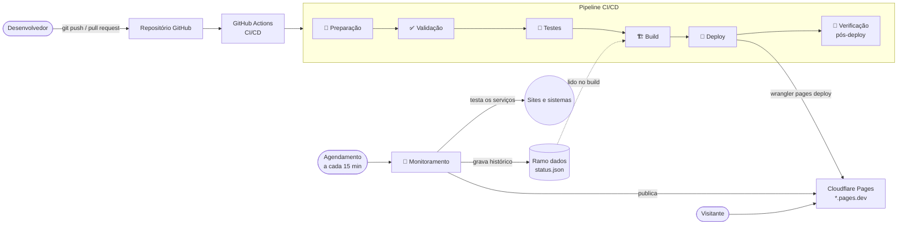

# Telemetria Status

Painel público que mostra, em tempo quase real, se os principais sites e sistemas estão no ar — no estilo do Downdetector —, com **CI/CD completo no GitHub Actions** e **deploy automático no Cloudflare Pages**.

| | |
|---|---|
| **Autor** | Joaquim Luiz Vitória Junior |
| **Disciplina** | Fundamentos de DevOps |
| **Professor** | Erik Rosa Filippini |
| **Site publicado** | `https://<nome-do-projeto>.pages.dev` *(preencher após o primeiro deploy)* |

## O que a aplicação faz

- Verifica **14 serviços** (Google, WhatsApp, gov.br, bancos, GitHub, Cloudflare, Netflix e outros) **a cada 15 minutos**.
- Classifica cada um como **operacional**, **lento**, **instável** ou **fora do ar**, mostra o tempo de resposta e a faixa das últimas 24 horas.
- Abre e encerra **incidentes** automaticamente, calcula a **disponibilidade** em 24 h, 7, 30 e 90 dias, o **tempo médio de recuperação** e marca serviços **oscilando**.
- Tem busca, filtros por categoria e situação e uma tela de detalhes por serviço.

Os conceitos vêm da **Central de Telemetria** que desenvolvo no trabalho (monitoramento de infraestrutura de segurança e rede): *debounce* de quedas, incidentes, SLA, MTTR e detecção de oscilação. Aqui eles foram aplicados a serviços públicos da internet, numa aplicação estática que roda inteira no Cloudflare Pages.

## Arquitetura



## Pipeline de CI/CD (`.github/workflows/ci-cd.yml`)

Roda a cada **push na `main`**, a cada **pull request** e sob demanda. Cada etapa só começa se a anterior passou (`needs`), então **um erro em qualquer etapa bloqueia o deploy** e o site no ar continua na última versão boa.

| Etapa | O que faz |
|---|---|
| 🔧 Preparação | Baixa o código, instala o Node.js 24 e as dependências, mostra o ambiente |
| ✅ Validação | Confere se o `index.html` existe, valida o HTML (html-validate), a sintaxe do JavaScript e a lista de serviços |
| 🧪 Testes | 20 testes automatizados (regras de estado, incidentes, SLA, verificador HTTP, configuração e build), com cobertura |
| 🏗 Build | Busca o histórico mais recente, gera a pasta `dist/` com `build-info.json` (versão, commit, execução) e guarda como **artefato** |
| 🚀 Deploy | Publica `dist/` no Cloudflare Pages com o Wrangler: **produção** na `main`, **prévia** com link comentado no pull request |
| 🔎 Verificação pós-deploy | Acessa o site publicado e confirma que ele responde com o commit que acabou de ser publicado |

## Monitoramento agendado (`.github/workflows/monitorar.yml`)

A cada 15 minutos: busca o histórico no ramo `dados`, testa os serviços, grava o resultado de volta no ramo `dados`, roda os testes e publica o painel atualizado. O histórico fica num ramo separado para não encher a `main` de commits automáticos.

## Estrutura

```
site/                 painel (HTML, CSS, JavaScript) — vai para o Cloudflare Pages
  js/nucleo.js        regras de estado, incidentes e SLA (usadas pelo painel e pelo verificador)
  js/app.js           montagem da tela
  _headers            cabeçalhos de segurança do Cloudflare Pages
config/servicos.json  lista de serviços monitorados
scripts/              verificador, validação da configuração e build
testes/               testes automatizados (node:test)
dados/status.json     arquivo inicial do histórico (o real fica no ramo "dados")
.github/workflows/    ci-cd.yml e monitorar.yml
docs/                 guia passo a passo e roteiro do vídeo
```

## Rodar na própria máquina

Pré-requisito: Node.js 22 ou superior.

```bash
npm install
npm run validar      # mesma validação do pipeline
npm test             # testes automatizados
npm run verificar    # verifica os serviços de verdade e grava dados/status.json
npm run local        # gera o dist/ e abre em http://localhost:3000
```

## Como acrescentar, editar ou remover serviços

A lista fica em `config/servicos.json`. Qualquer alteração nela passa pelo pipeline: se a validação recusar, nada é publicado.

1. **Pelo próprio site:** botão **Adicionar ou editar serviços** → preencha nome, categoria e endereço → **Gerar a linha do serviço**. O formulário valida com as mesmas regras do pipeline, copia a linha pronta e abre o arquivo no editor do GitHub; cole a linha antes do `]` final e clique em **Commit changes**.
2. **Pelo GitHub:** abra `config/servicos.json` no repositório, clique no lápis (**Edit this file**), altere ou apague a linha do serviço e faça o commit.
3. **Pelo computador:** edite o arquivo no VS Code e rode `git add .`, `git commit` e `git push`.

Um serviço novo aparece no painel como "Aguardando verificação" até a próxima rodada do monitoramento; para verificar na hora, rode o workflow **Monitoramento** em **Actions → Run workflow**.

Formato de cada linha:

```json
{ "id": "meu-servico", "nome": "Meu Serviço", "categoria": "Trabalho", "url": "https://meuservico.com.br/" }
```

Campos opcionais: `limite_lento_ms` (padrão 2000) e `timeout_ms` (padrão 10000). Categorias aceitas: Comunicação, Redes sociais, Governo, Bancos e pagamentos, Compras, Nuvem e desenvolvimento, Entretenimento, Trabalho. A etapa de validação do pipeline recusa campos inválidos.

## Limitações

- As verificações saem dos servidores do GitHub, na internet pública: medem se o serviço responde de lá, não da sua rede. Sistemas internos de empresas não podem ser testados.
- O GitHub pode atrasar execuções agendadas em horários de pico; o intervalo real pode passar de 15 minutos.
- Uma resposta HTTP abaixo de 500 (inclusive 403 de sites que bloqueiam robôs) conta como "no ar": o servidor respondeu.

Guia de configuração: [docs/GUIA-PASSO-A-PASSO.md](docs/GUIA-PASSO-A-PASSO.md) · Roteiro do vídeo: [docs/ROTEIRO-DO-VIDEO.md](docs/ROTEIRO-DO-VIDEO.md)
